# image-preview-studio

**image-preview-studio** is a drop-in image editor for web and mobile browsers, with 14 adjustments.
You can turn each tool on or off with `true` / `false`. The image is never stretched, and the UI is clean and touch friendly.

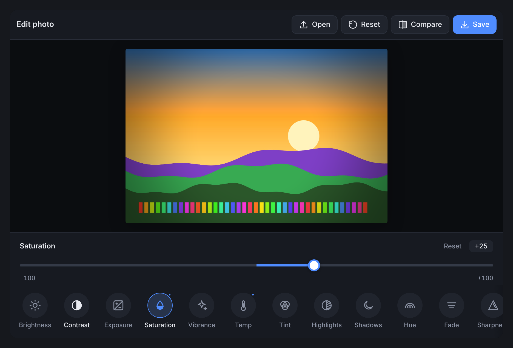

```bash
npm i image-preview-studio
```

- 14 tools: brightness, contrast, exposure, saturation, vibrance, temperature, tint, highlights, shadows, hue, fade, sharpness, vignette, grain
- **Enable or disable any tool** with `true` / `false`
- **The image keeps its real aspect ratio.** It is never stretched or squashed, and small images stay at their real size.
- Fast live preview, and **full-resolution** export
- Dark and light themes, custom accent colour, custom labels
- Works with **plain JS, React, Next.js, Vue, Angular, Svelte**, or a `<script>` tag
- No dependencies, about 24 KB minified

---

## Contents

- [Quick start](#quick-start)
- [React / Next.js](#react--nextjs)
- [CDN (no build step)](#cdn-no-build-step)
- [All tools](#all-tools)
- [Enable / disable tools](#enable--disable-tools)
- [Light theme & accent colour](#light-theme--accent-colour)
- [Starting values & custom labels](#starting-values--custom-labels)
- [Images never stretch](#images-never-stretch)
- [Mobile](#mobile)
- [Hold to compare](#hold-to-compare)
- [Without header (minimal embed)](#without-header-minimal-embed)
- [Empty state / upload](#empty-state--upload)
- [Save & export](#save--export)
- [Use the filters without the UI](#use-the-filters-without-the-ui)
- [Options](#options)
- [Methods](#methods)

---

## Quick start


```html
<div id="editor" style="height: 600px"></div>
```

```js
import { createImageStudio } from 'image-preview-studio';

const editor = createImageStudio('#editor', {
  src: '/photo.jpg',
  onChange: (values) => console.log(values),
});
```

> The editor fills its container, so give the container a height.

---

## React / Next.js


```tsx
import { useRef } from 'react';
import { ImageStudioEditor, type ImageStudioHandle } from 'image-preview-studio/react';

export default function PhotoEditor() {
  const ref = useRef<ImageStudioHandle>(null);

  const upload = async () => {
    const blob = await ref.current!.toBlob('image/jpeg', 0.9);
    // send blob to your server…
  };

  return (
    <>
      <ImageStudioEditor
        ref={ref}
        src="/photo.jpg"
        height="600px"
        onChange={(values) => console.log(values)}
      />
      <button onClick={upload}>Upload</button>
    </>
  );
}
```

The React entry already has `"use client"`, so it works in the Next.js App Router.
All props update live. If you change `tools`, `theme` or `src`, the editor updates without losing the user's edits.

---

## CDN (no build step)

```html
<script src="https://unpkg.com/image-preview-studio"></script>

<div id="editor" style="height: 100vh"></div>

<script>
  ImagePreviewStudio.create('#editor', { src: 'photo.jpg' });
</script>
```

---

## All tools

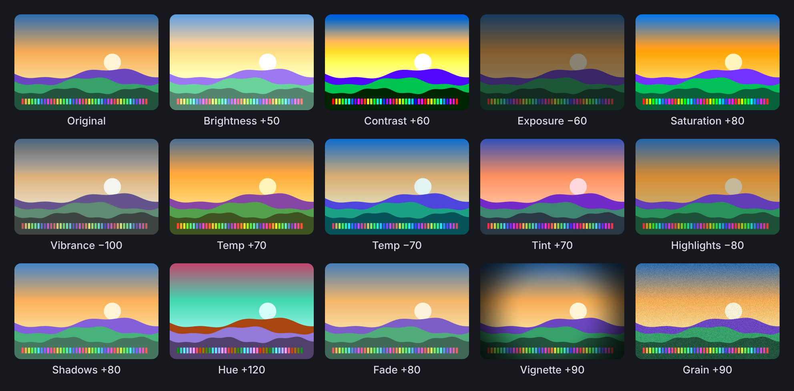

| key | range | | key | range |
|---|---|---|---|---|
| `brightness` | -100 … 100 | | `shadows` | -100 … 100 |
| `contrast` | -100 … 100 | | `hue` | -180 … 180 |
| `exposure` | -100 … 100 | | `fade` | 0 … 100 |
| `saturation` | -100 … 100 | | `sharpness` | 0 … 100 |
| `vibrance` | -100 … 100 | | `vignette` | 0 … 100 |
| `temperature` | -100 … 100 | | `grain` | 0 … 100 |
| `tint` | -100 … 100 | | | |
| `highlights` | -100 … 100 | | | |

Every tool starts at `0`, which means no change.

---

## Enable / disable tools

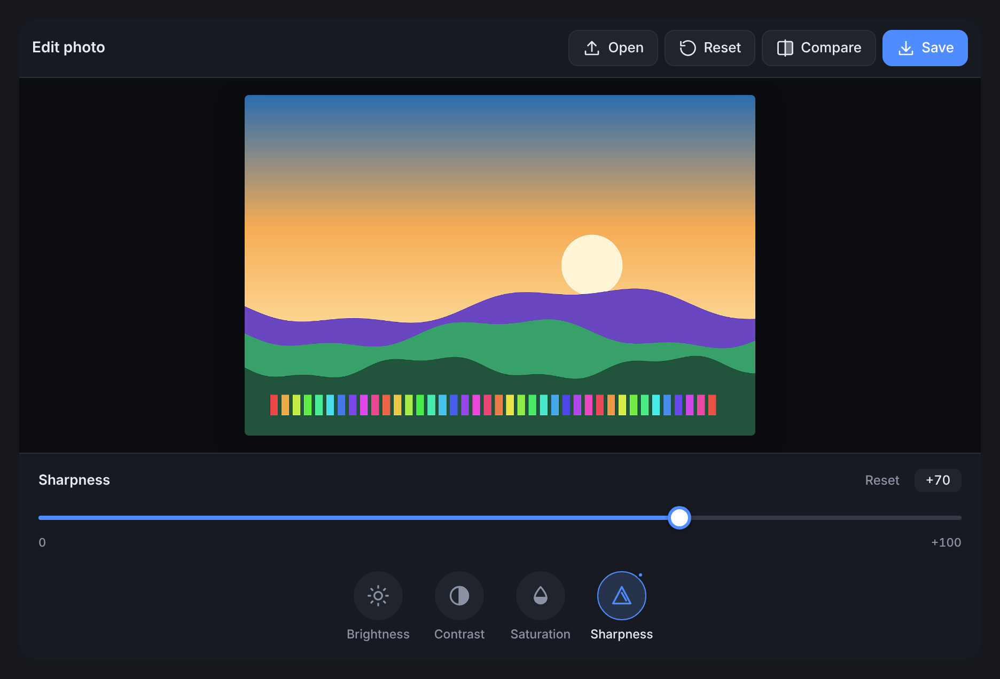

Pass `false` to hide a tool. A tool you don't mention is shown.

```js
createImageStudio('#editor', {
  src: '/photo.jpg',
  tools: {
    brightness: true,
    contrast: true,
    saturation: true,
    sharpness: true,
    exposure: false,
    vibrance: false,
    temperature: false,
    tint: false,
    highlights: false,
    shadows: false,
    hue: false,
    fade: false,
    vignette: false,
    grain: false,
  },
});
```

React:

```tsx
<ImageStudioEditor src={url} tools={{ grain: false, hue: false }} />
```

A hidden tool has no effect on the image, even if you pass it a value.
When only a few tools are left, the row centres itself.

---

## Light theme & accent colour

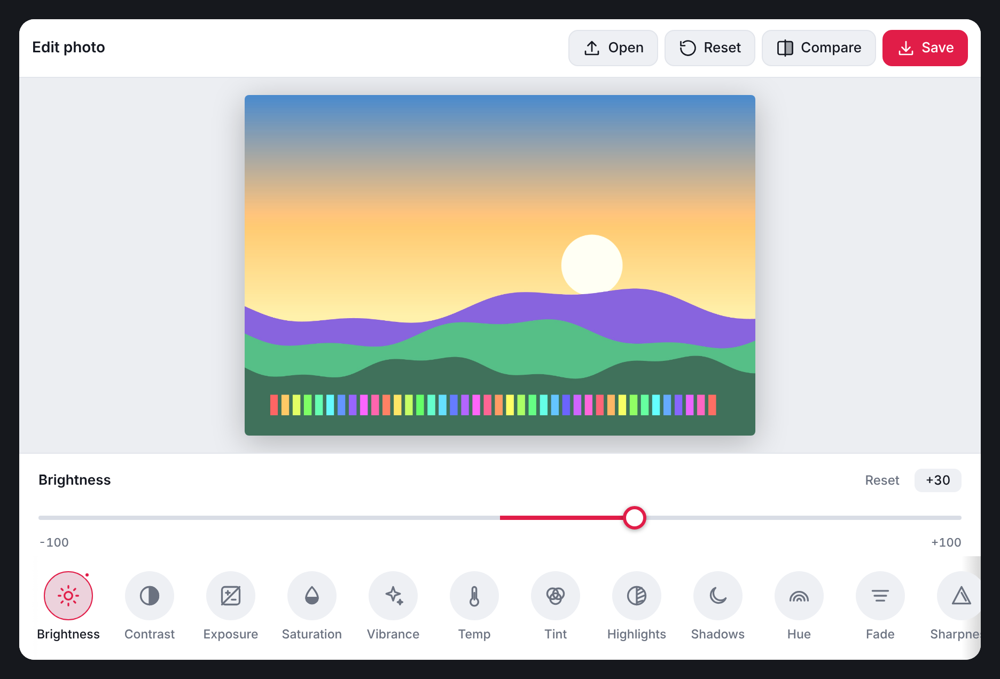

```js
createImageStudio('#editor', {
  src: '/photo.jpg',
  theme: 'light',      // 'dark' (default) | 'light'
  accent: '#e11d48',   // slider, active tool, Save button
});
```

Change it live:

```js
editor.update({ theme: 'dark', accent: '#16a34a' });
```

---

## Starting values & custom labels

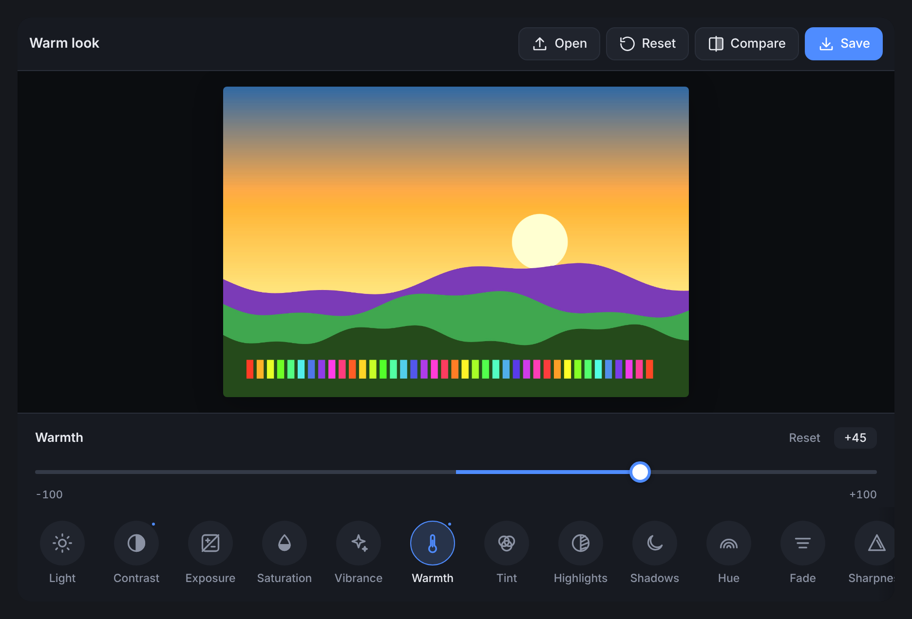

```js
createImageStudio('#editor', {
  src: '/photo.jpg',
  title: 'Warm look',
  values: { temperature: 45, contrast: 15 },          // start already edited
  labels: { temperature: 'Warmth', brightness: 'Light' },
  activeTool: 'temperature',                           // which slider opens first
});
```

A small dot shows on every tool that has been changed.

---

## Images never stretch

**Portrait image (1080 × 1920) in a wide editor:**

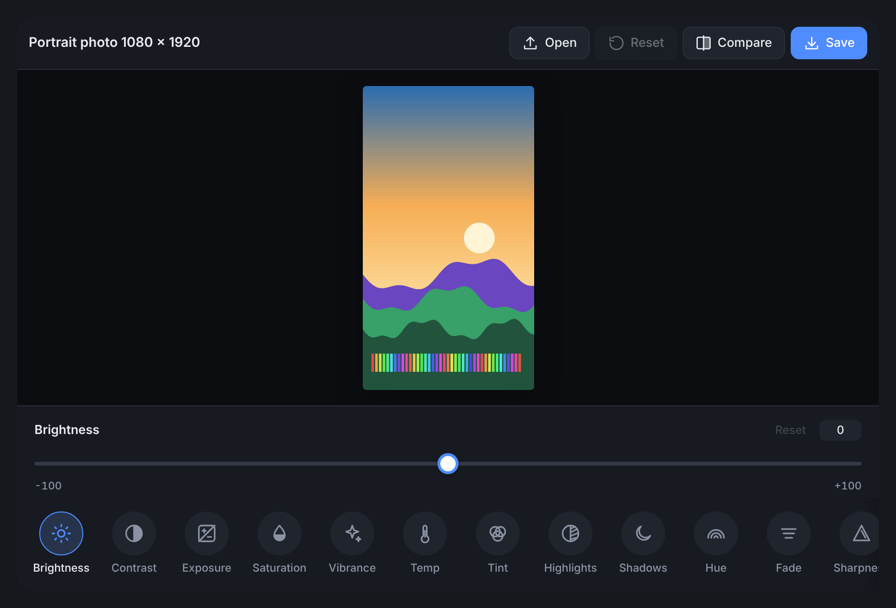

**Small image (320 × 220) stays at its real size:**

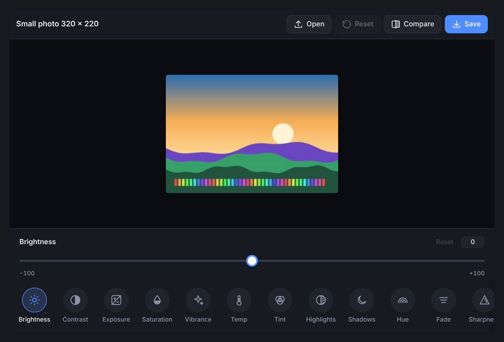

```js
createImageStudio('#editor', {
  src: '/small-photo.jpg',
  upscale: false,   // default: small images are not blown up
});
```

The image is scaled down only when it doesn't fit, always keeping its exact aspect ratio.
Set `upscale: true` if you want small images to grow and fill the space.

---

## Mobile

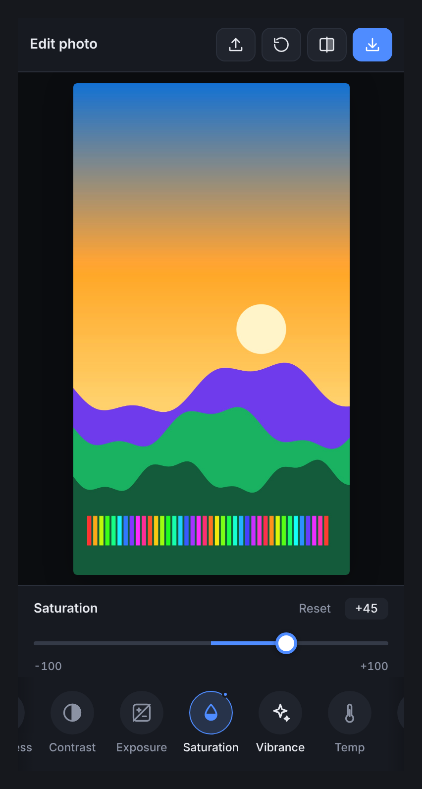

```css
#editor { height: 100dvh; }
```

```js
createImageStudio('#editor', { src: '/photo.jpg' });
```

Below 520 px wide, the header buttons become icons only and the tools turn into a swipeable row.
The slider thumb is large enough for fingers, and the layout respects the iPhone safe area.
It works in mobile browsers, PWAs, **Ionic / Capacitor**, and a **React Native `WebView`**.

---

## Hold to compare

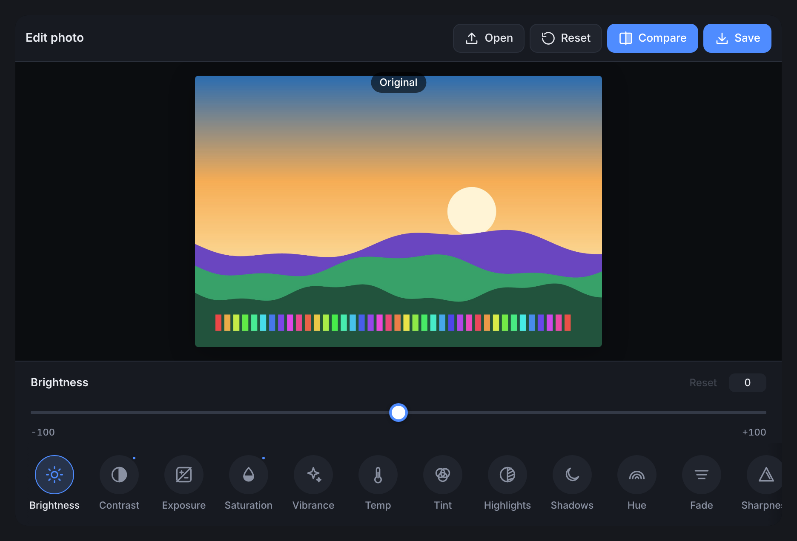

Press and hold **Compare** to see the original image. Let go to see your edits again.

```js
createImageStudio('#editor', {
  src: '/photo.jpg',
  compare: true,   // default
});
```

---

## Without header (minimal embed)

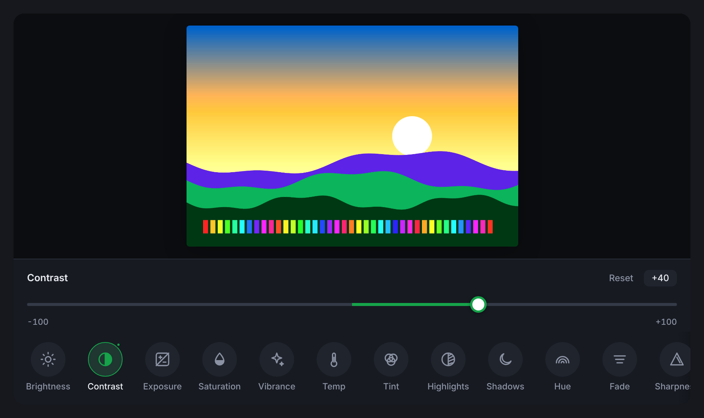

```js
createImageStudio('#editor', {
  src: '/photo.jpg',
  header: false,
  accent: '#16a34a',
});

// use your own buttons
document.querySelector('#save').onclick = () => editor.download({ fileName: 'photo.jpg' });
```

You can also hide individual buttons with `upload: false`, `reset: false`, `compare: false` or `download: false`.

---

## Empty state / upload

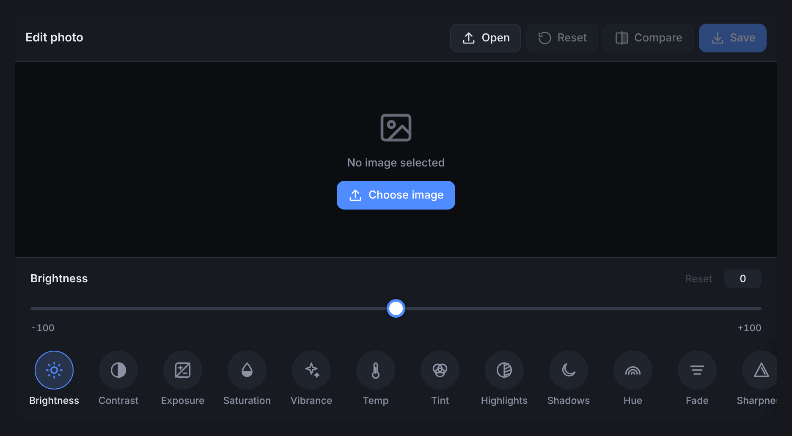

```js
const editor = createImageStudio('#editor');   // no src → "Choose image"

// or load from your own file input
input.onchange = (e) => editor.setImage(e.target.files[0]);
```

`src` can be a URL, data URL, `File`, `Blob`, ``, `<canvas>` or `ImageBitmap`.

---

## Save & export

Export always uses the **original full resolution**, not the smaller preview.

```js
const blob    = await editor.toBlob('image/jpeg', 0.9);  // upload to server
const dataUrl = editor.toDataURL('image/png');
const canvas  = editor.toCanvas();

await editor.download({ fileName: 'edited.jpg', type: 'image/jpeg', quality: 0.92 });
```

Upload example:

```js
const form = new FormData();
form.append('photo', await editor.toBlob('image/jpeg', 0.9), 'photo.jpg');
await fetch('/api/upload', { method: 'POST', body: form });
```

---

## Use the filters without the UI

```js
import { applyFilters } from 'image-preview-studio';

const canvas = await applyFilters(file, { brightness: 15, sharpness: 40, temperature: 20 });
canvas.toBlob((blob) => { /* … */ }, 'image/jpeg', 0.9);
```

---

## Options

| option | default | what it does |
|---|---|---|
| `src` | – | URL, data URL, `File`, `Blob`, ``, `<canvas>`, `ImageBitmap` |
| `tools` | all `true` | `{ toolName: true / false }` |
| `values` | all `0` | starting values |
| `labels` | – | rename tools |
| `theme` | `'dark'` | `'dark'` or `'light'` |
| `accent` | `#4f8cff` | accent colour |
| `height` | `'100%'` | editor height (any CSS value) |
| `header` | `true` | show the top bar |
| `title` | `'Edit photo'` | top bar title |
| `upload` | `true` | Open button and empty state picker |
| `reset` | `true` | Reset-all button |
| `compare` | `true` | hold-to-compare button |
| `download` | `true` | Save button, or `{ fileName, type, quality }` |
| `upscale` | `false` | let small images grow to fill the space |
| `previewSize` | `1600` | longest side of the live preview (px) |
| `activeTool` | first tool | slider shown first |
| `onChange(values, tool)` | – | called on every change |
| `onReady({ width, height })` | – | called when an image has loaded |
| `onError(error)` | – | called when an image fails to load |

## Methods

```js
editor.setImage(src)                 // load another image
editor.getValues()                   // { brightness: 0, contrast: 12, … }
editor.setValues({ tint: 10 })
editor.setValue('brightness', 30)
editor.reset()                       // reset all
editor.reset('contrast')             // reset one tool
editor.selectTool('sharpness')
editor.update({ theme: 'light', tools: { grain: false } })
await editor.toBlob(type, quality)
editor.toDataURL(type, quality)
editor.toCanvas()
await editor.download({ fileName, type, quality })
editor.destroy()
```

## Tips

- **Double-click the slider** to reset that tool.
- To edit remote images, the server must send CORS headers (`Access-Control-Allow-Origin`).
  Images picked from the device always work.
- TypeScript types are included.

## License

MIT
"# image-preview-studio" 
